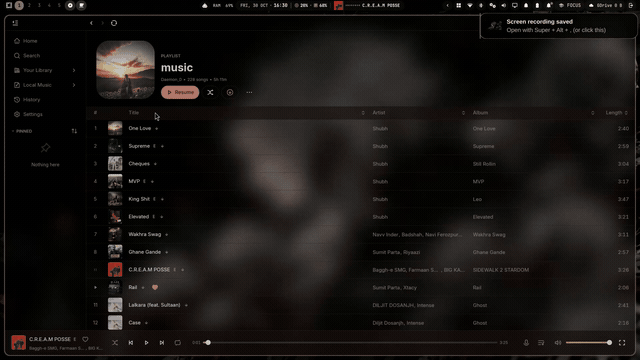

# Omarchy Shell Polish (`omarchy-shell-polish`)

> **Unofficial / Community Refinement**: A curated collection of Hyprland and Omarchy shell configuration snippets for frosted glass aesthetics, floating bar layout, and ergonomic keybinding polish.

Version 1.7 adds the **Windows & macOS-style Floating Desktop Experience**: freeform floating window management, native `hyprbars` titlebars with Close (`×`), Maximize (`□`), and Minimize (`−`) buttons, titlebar double-click maximization, an interactive bottom desktop dock (`omarchy.dock`) acting as the minimization shelf and pinned app launcher, drop shadows for depth, solid opacity overrides, and seamless layout cycling (`SUPER + L` / `SUPER + ALT + L`). See [Floating Mode Guide](docs/FLOATING-MODE.md).

Version 1.6 adds native background-only glass for Spotify, Files, ChatGPT, the AntiGravity app and Foot, with solid foreground content and gentle compositor blur. Spotify fullscreen color backdrops and decorative gradients are removed. See [background glass setup](reference/background-glass/README.md) and [Spotify live sync](reference/spotify-sync/README.md). The optional [universal monitor](reference/background-glass/universal/README.md) covers current/future installed desktop apps and notifies when a native theme recipe is missing. Pet changes are excluded.

Version 1.4 adds a quieter shared glass material, compact menu motion, a Caelestia SearchBar refinement and an optional minimal live-status lock view. See [balanced glass references](reference/shared-glass/README.md) and [lock integration boundaries](reference/modern-lock/README.md).

Version 1.1 adds preset-aware native controls for Omarchy and a Caelestia overlay for DaemonOS. It preserves both desktop identities and retains the original optional snippets. See [Refinement and rollback](docs/REFINEMENT.md) and [component licensing](docs/COMPONENT-PROVENANCE.md).

This project was developed through an AI-assisted workflow. The concept, customization, configuration, testing, integration, and final iteration were directed and carried out by me.

---

## My Contribution

I did not write Omarchy, Quickshell, or Hyprland from scratch. What I contributed:

- **Floating Mode & Windows/macOS Desktop UX** (`snippets/floating-mode.lua` & `docs/FLOATING-MODE.md`): Integrated the floating desktop workflow with `hyprbars` native titlebars (Close, Maximize/Restore, Minimize to Dock), double-click to maximize, interactive bottom dock integration (`omarchy.dock` / `omarchy-dock`), drop-shadow depth, and solid opacity overrides.
- **Ergonomic Keybindings Snippet** (`snippets/bindings-ergonomic.lua`): Fully audited all live Hyprland keybindings against Omarchy distribution defaults. Restored and wired workspace layout cycling (`SUPER + L` / `SUPER + ALT + L` for Tiling -> Scrolling -> Floating), window floating toggle (`SUPER + T`), core Omarchy window management (`SUPER + P`, `SUPER + S`, `SUPER + SHIFT + SPACE`), and productivity shortcuts.
- **Frosted Glass Snippet** (`snippets/looknfeel-glass.lua`): Tuned Hyprland `decoration` parameters — blur radius, passes, layerrule blur targets, window opacity, and shadow settings — to produce a frosted glass aesthetic on Wayland.
- **Floating Bar Layout Snippet** (`snippets/shell-bar-layout.json`): Designed a `shell.json` layout configuration placing a center island telemetry widget (`daemon0.system-pulse`) with balanced left and right widget clusters for the Omarchy Quickshell bar.
- **Interactive Dock Layout Snippet** (`snippets/shell-dock-layout.json`): Configured the Quickshell desktop dock for pinned apps and minimization shelf.
- **Installer**: Authored `./install.sh check` for dependency validation.
- **Documentation**: Wrote all snippet descriptions, usage instructions, and manual application guides.
- **Testing**: Tested all snippets on Omarchy 4.0.2 / Hyprland 0.56.2 on a supported Linux desktop.

---

## Based On / Credits

- **[Omarchy](https://github.com/basecamp/omarchy)** — The open-source Arch Linux desktop environment by Basecamp. All snippets are designed as drop-in complements to Omarchy's configuration files (`looknfeel.lua`, `shell.json`, `bindings.lua`). No Omarchy core files are replaced.
- **[Hyprland](https://hyprland.org)** — The Wayland tiling compositor whose configuration system (`decoration`, `animations`, `binds`) these snippets target.
- **[Quickshell](https://quickshell.outfoxxed.me)** — The Qt6 QML desktop shell. The bar layout snippet targets Quickshell's `shell.json` widget configuration.

**Related Repos**:
- [omarchy-motion-presets](https://github.com/aarushdalal/omarchy-motion-presets) — 19 Hyprland animation preset Lua files
- [omarchy-theme-transitions](https://github.com/aarushdalal/omarchy-theme-transitions) — GPU GLSL theme transition shaders
- [omarchy-system-pulse](https://github.com/aarushdalal/omarchy-system-pulse) — System telemetry center-island widget
- [omarchy-aesthetic-themes](https://github.com/aarushdalal/omarchy-aesthetic-themes) — Anime color themes and live wallpapers

---

## Repository Structure

```
omarchy-shell-polish/
├── snippets/
│   ├── floating-mode.lua         # Windows & macOS-style floating mode + hyprbars titlebars
│   ├── shell-dock-layout.json    # Interactive dock configuration & pinned apps
│   ├── looknfeel-glass.lua       # Frosted glass blur + opacity parameters
│   ├── shell-bar-layout.json     # Center island floating bar layout
│   └── bindings-ergonomic.lua    # Ergonomic keybinding set (Super+L, Super+T, etc.)
├── assets/showcase/
├── docs/
│   ├── FLOATING-MODE.md          # Comprehensive Floating Desktop UX guide
│   ├── BAR-POLISH.md             # Top bar and bottom dock layout guide
│   └── KEYBINDING-AUDIT.md       # Conflict-free keybinding audit table
├── install.sh
└── CHANGELOG.md
```

---

## Snippets Overview

### 1. Floating Desktop Mode (`snippets/floating-mode.lua`)

Transforms any workspace into a freeform floating desktop experience:

- Native `hyprbars` window titlebars with Close (`×`), Maximize (`□`), and Minimize (`−`) controls.
- Double-clicking titlebars toggles maximized state.
- Drop shadows (`range: 16`, `render_power: 3`) for natural visual depth across overlapping windows.
- Solid opacity override (`1.0`) ensuring background documents never bleed through.
- Detailed guide: [docs/FLOATING-MODE.md](docs/FLOATING-MODE.md).

### 2. Ergonomic Keybindings (`snippets/bindings-ergonomic.lua`)

A conflict-free, fully-audited Hyprland keybinding set:

- **Workspace Layout Cycling**: `SUPER + L` (Cycle forward: Tiling → Scrolling → **Floating**), `SUPER + ALT + L` (Cycle backward).
- **Window Management**: `SUPER + T` (float single window), `SUPER + P` (pseudo), `SUPER + S` (scratchpad), `SUPER + SHIFT + SPACE` (top bar toggle).
- **Universal Shortcuts**: media playback (`SUPER + \`), app launcher (`SUPER + D`), LazyGit (`SUPER + CTRL + G`), Config Time Machine (`SUPER + ALT + H`), screenshot (`SUPER + SHIFT + S`), Study Focus (`SUPER + CTRL + ALT + S`).
- Eliminates duplicate volume key dispatches and conflicting application hotkeys.

### 3. Frosted Glass (`snippets/looknfeel-glass.lua`)

Hyprland `decoration` parameters for frosted glass window and layer blur:

- Blur radius, passes, and `layerrule blur` targets for the Omarchy top bar and pop-ups.
- Window opacity tuned for terminals and editors.
- Shadow spread and color matched to active Omarchy theme accent.

Apply by merging into `~/.config/hypr/looknfeel.lua` and running `hyprctl reload`.

### 4. Floating Bar Layout (`snippets/shell-bar-layout.json`)

A `shell.json` layout snippet for the Omarchy Quickshell bar:

- Places `daemon0.system-pulse` as the center anchor.
- Balances left cluster (workspaces, active window) and right cluster (cloud sync, config time machine, tray, clock).

Merge into `~/.config/omarchy/shell.json` and run `omarchy-restart-shell`.

### 5. Interactive Desktop Dock (`snippets/shell-dock-layout.json`)

A `shell.json` dock snippet for floating workspaces:

- Surfaces on floating workspaces as the dedicated shelf for minimized windows and pinned quick-launch applications.
- Supports bottom, top, left, or right positioning and auto-hide mode.

Merge into `~/.config/omarchy/shell.json` under `"dock"` and run `omarchy-restart-shell`.

---

## Requirements

- **Omarchy** `dev (13f18b2c) / 4.0.2`
- **Hyprland** `0.56.2`
- **Quickshell** `0.3.1`

---

## Installation & Usage

1. Inspect snippets:
   ```bash
   ./install.sh check
   ```
2. Back up your existing files:
   ```bash
   cp ~/.config/hypr/looknfeel.lua ~/.config/hypr/looknfeel.lua.bak
   cp ~/.config/omarchy/shell.json ~/.config/omarchy/shell.json.bak
   cp ~/.config/hypr/bindings.lua ~/.config/hypr/bindings.lua.bak
   ```
3. Copy desired snippets into your configuration files:
   ```bash
   # Example — merge glass snippet
   cat snippets/looknfeel-glass.lua >> ~/.config/hypr/looknfeel.lua
   hyprctl reload
   ```

---

## Showcase

**Latest supplied desktop showcase — 30 October 2026** · 2 min 39 sec · Full HD at 60 FPS · soundtrack included.

[](https://aarushdalal.github.io/omarchy-shell-polish/#showcase)

[Watch the full showcase](https://aarushdalal.github.io/omarchy-shell-polish/#showcase) · [Download WebM](https://aarushdalal.github.io/omarchy-shell-polish/assets/showcase/desktop-showcase-2026-10-30.webm) · [What the video shows](docs/SHOWCASE.md)

The animated image combines four short highlights; the player contains the complete edited recording with its soundtrack. It replaces the previous README recording and the gallery's sample illustration.

This is my configured desktop: floating shell controls, glass windows, terminal layouts, system panels, wallpaper changes and animation presets. The recording includes companion tools and artwork beyond this repository's portable snippets. See the [showcase guide](docs/SHOWCASE.md) for scope and chapter notes.

---

## License

[MIT License](LICENSE).

## Refinement and privacy update

Floating native controls · profile identity preserved. The latest video shows the recorded desktop; the session-component fixture uses sample data. See [release privacy](docs/RELEASE-PRIVACY.md). Existing Git history is preserved.
