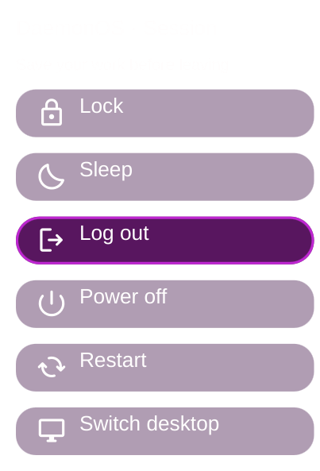

# Floating refinement for both desktops

Preserves Omarchy theme tokens and command menu, and Caelestia colors, typography,
drawers and session animation. Existing motion preset names stay intact.

Run `./install.sh check` to list changes. `./install.sh apply` installs user-owned
Omarchy plugin clones and overlays an existing user-owned Caelestia tree. It
preserves the shell layout, replaces six native widget IDs plus owned OSD/notification providers and adds Session.
Never apply over a different Caelestia version without reviewing the overlay.
The implementation was validated against Quickshell 0.3.1 and the installed
Caelestia components on 2026-10-11; future upstream changes can need rebasing.

Install `omarchy-motion-presets` for the selector and `arch-multienv` for the
`multienv-logout` command before using Session. The Omarchy clones delegate to its
native Motion singleton. DaemonOS uses a separate compatible provider reading
the same style, intensity and reduced-motion state. All 19 styles retain their
individual timing/easing. Reduced motion suppresses translation/scaling and uses
a short fade. Caelestia loaders wait for replacement content to be ready.

Omarchy hot-reloads user plugins. DaemonOS applies its components next session
when watchFiles is disabled. Do not restart a shell while its lock is active.

The installer prints a recovery journal. Use `./install.sh rollback DIRECTORY`
to restore exact preimages and remove new files. Files changed subsequently are
preserved. Inspect the journal before rolling back. This does not perform logout,
reboot, SDDM restart, authentication changes, or vendor shell writes.

Native component compile tests and 114 preset/intensity/reduced combinations
passed; actual login/authentication and full session switching still require
an interactive test. See COMPONENT-PROVENANCE.md for MIT/GPL boundaries.

Native component fixture using sample state and the existing theme palette; GIF
hidden for this preview. It verifies layout, rather than a real session logout.

Session exposes Lock and Sleep directly; logout, desktop switch, restart and
power-off require confirmation. Logout pauses for remaining windows and offers
a clearly explicit force action. DaemonOS shows Hibernate only when logind
reports it supported. Desktop switching requires manual greeter mode and never
silently changes autologin policy.
