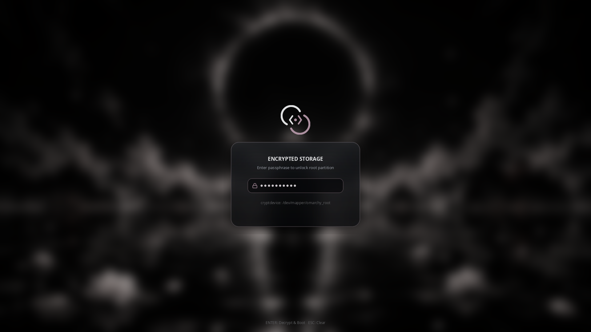

# Encrypted Disk Boot Unlock, Shutdown Splash & Automated Theme Sync

This module provides a unified **Theme-Adaptive Frosted Monolith** aesthetic and automated wallpaper/palette synchronization across early-boot Linux storage unlock (Plymouth LUKS), post-unlock loading, shutdown/reboot screens, and the login manager (SDDM).



## What It Does

- **Theme-Adaptive Frosted Monolith (`render_assets.py`)**: Reads `/var/cache/multienv/colors.json` and dynamically renders a translucent frosted-glass container (`card.png` with subtle wallpaper refraction, top specular edge highlight, and theme `accent` rim), visible `entry.png` pill, themed `lock.png`, `bullet.png`, progress track/bar, and contrast-guarded typography for both dark and light themes.
- **Single Master SVG -> Automatic Per-Theme PNGs**: Uses `resvg` (or `rsvg-convert`) to render `brand-logo.svg.tpl` into `logo.png` during theme sync, floating cleanly above the frosted LUKS card, centered during post-unlock loading, and animated with a 50 FPS gliding pulse pill on shutdown/reboot.
- **Zero-Prompt Background Initramfs Rebuild**: Generates the unified kernel image (`limine-mkinitcpio`) in the background with desktop sync notifications (`notify-send`).

---

## Installation & Setup

1. **Deploy the Plymouth Theme Assets**:
   ```bash
   sudo cp -r /usr/share/plymouth/themes/omarchy /usr/share/plymouth/themes/omarchy.bak
   sudo cp omarchy.script omarchy.script.tpl render_assets.py brand-logo.svg.tpl card.png /usr/share/plymouth/themes/omarchy/
   sudo chmod 755 /usr/share/plymouth/themes/omarchy/render_assets.py
   sudo plymouth-set-default-theme omarchy
   ```

2. **Install Background Sync Script & Sudoers Permission**:
   ```bash
   sudo cp omarchy-plymouth-sync /usr/local/bin/omarchy-plymouth-sync
   sudo chmod 755 /usr/local/bin/omarchy-plymouth-sync
   echo "$USER ALL=(ALL) NOPASSWD: /usr/local/bin/omarchy-plymouth-sync" | sudo tee /etc/sudoers.d/99-omarchy-plymouth-sync
   ```

3. **Install Theme Hook & SVG Logo Template**:
   ```bash
   mkdir -p ~/.config/omarchy/hooks/theme-set.d ~/.config/omarchy/boot-unlock
   cp brand-logo.svg.tpl ~/.config/omarchy/boot-unlock/brand-logo.svg.tpl
   cp 25-sddm-wallpaper-sync.sh ~/.config/omarchy/hooks/theme-set.d/25-sddm-wallpaper-sync.sh
   chmod 755 ~/.config/omarchy/hooks/theme-set.d/25-sddm-wallpaper-sync.sh
   ```

4. **Run First Sync**:
   ```bash
   ~/.config/omarchy/hooks/theme-set.d/25-sddm-wallpaper-sync.sh
   ```
